<a id="readme-top"></a>

<p align="center">
  <a href="https://letscook-organization.github.io/CodeOrbit/">
    
  </a>
</p>

<p align="center">
  <a href="https://letscook-organization.github.io/CodeOrbit/"></a>
  <a href="https://github.com/LetsCook-Organization/CodeOrbit/actions/workflows/ci.yml"></a>
  <a href="https://github.com/LetsCook-Organization/CodeOrbit/releases"></a>
  <a href="https://github.com/LetsCook-Organization/CodeOrbit/issues?q=is%3Aopen+label%3A%22good+first+issue%22"></a>
  <a href="LICENSE"></a>
</p>

<p align="center">
  <a href="https://letscook-organization.github.io/CodeOrbit/"><b>Open the app</b></a>
  &nbsp;·&nbsp;
  <a href="#01--the-problem"><b>What is this?</b></a>
  &nbsp;·&nbsp;
  <a href="#07--open-issues-start-here"><b>Pick an issue</b></a>
  &nbsp;·&nbsp;
  <a href="#08--your-first-contribution-step-by-step"><b>Contribute</b></a>
  &nbsp;·&nbsp;
  <a href="#11--questions"><b>FAQ</b></a>
</p>


## 00 — In one minute

| Question | Short answer |
| :--- | :--- |
| **What is it?** | A free website that keeps track of your coding journey: what you are learning, how much you study, what you are building and what you want to achieve. |
| **Who is it for?** | Students and anyone learning to code on their own. |
| **What does it cost?** | Nothing. No sign-up, no account, nothing to install. |
| **Where is my data?** | Only in your own browser, on your own computer. We never see it. |
| **How finished is it?** | **Version 0.1.0.** It works, but it is young. There are open issues if you want to help. |
| **Who makes it?** | [Let's Cook](#12--about-lets-cook), an open-source tech community. |


## 01 — The problem

When you learn to code, your progress ends up **everywhere**:

- notes in one app, tutorials in your bookmarks,
- projects on GitHub, goals only in your head,
- and no record of how much you actually studied.

So you cannot easily answer simple questions like:

> *How many hours did I study this week?*<br>
> *Am I actually getting better at Python?*<br>
> *Which of my projects is stuck?*<br>
> *Did I miss the deadline I set myself?*

When you cannot **see** your progress, it feels like you are not making any. That is when most people lose motivation and quit.

## 02 — The solution

**CodeOrbit is one page where you write down what you learn, and it turns that into numbers and pictures you understand at a glance.**

It uses a small space theme: on Home, each skill you add is a planet in your orbit, and it grows as you get better. The words stay simple:

| Page | What it is | Example |
| :--- | :--- | :--- |
| **Home** | This week at a glance and what is coming up | "6.5 of 12 hours studied" |
| **Skills** | What you are learning | "Python, 60%" |
| **Study sessions** | Each time you studied | "Studied React hooks, 1h 30m" |
| **Projects** | Things you are building | "Portfolio website, 70% done" |
| **Goals** | What you want to reach, with a due date | "Finish the Docker course by 30 Nov" |
| **Progress** | Charts, your progress score and badges | "You studied 7 days in a row" |


## 03 — What you can do

<table>
  <tr>
    <td width="50%" valign="top">
      <h3>🛸 See everything at once</h3>
      The home screen shows your study streak, total hours, active projects, upcoming goals, a weekly chart, and your skills as planets that grow with your progress.
    </td>
    <td width="50%" valign="top">
      <h3>🪐 Track your skills</h3>
      Add skills in 9 categories (Web Development, AI, DevOps, Data Science…). Set a level from Beginner to Expert, and move progress up or down by 10% with one click.
    </td>
  </tr>
  <tr>
    <td width="50%" valign="top">
      <h3>📝 Log study sessions</h3>
      Write down what you studied, for how long, and how (coding, reading, practice problems, tutorials, research, project work). Your streak updates by itself.
    </td>
    <td width="50%" valign="top">
      <h3>🛰️ Manage projects</h3>
      Keep each project's status (Planning, In Progress, On Hold, Completed), progress, technologies, GitHub link and live link in one place.
    </td>
  </tr>
  <tr>
    <td width="50%" valign="top">
      <h3>🎯 Set goals</h3>
      Give goals a deadline and a priority (Critical, High, Medium, Low). CodeOrbit shows how many days are left and warns you when one is overdue.
    </td>
    <td width="50%" valign="top">
      <h3>⭐ Earn badges</h3>
      10 achievements unlock as you go: your first skill, a 3-day streak, 7-day streak, 100 hours of learning, and more.
    </td>
  </tr>
  <tr>
    <td width="50%" valign="top">
      <h3>📊 Understand your habits</h3>
      5 charts (this week, last 30 days, skills by category, project status, type of study) plus short insights, like your most-studied skill.
    </td>
    <td width="50%" valign="top">
      <h3>⚙️ Make it yours</h3>
      Dark or light theme, daily and weekly study targets, sounds on or off. Search everything with <kbd>Ctrl</kbd> + <kbd>K</kbd>. Back up and restore your data as a file.
    </td>
  </tr>
</table>

### The productivity score (0–100), explained

The home screen shows one number that sums up your week. It is made of four simple parts:

| Part | Points | How you earn them |
| :--- | ---: | :--- |
| **Consistency** | 30 | How many of the last 7 days you studied |
| **Study hours** | 30 | Hours this week compared with your weekly target |
| **Projects** | 20 | Average progress of your projects |
| **Skills** | 20 | Average progress of your skills |

A brand-new account scores **0**. In the app, click **"How is this computed?"** next to the score to see exactly how yours was calculated.


## 04 — How it works

<p align="center">
  
</p>

There is **no server and no database**. CodeOrbit is a single web page. Everything you type is saved in your browser's built-in storage (called `localStorage`), on your own computer.

- ✅ **Private:** your data is never sent anywhere. There is no login and no analytics.
- ✅ **Fast:** nothing to wait for; it all happens on your computer.
- ⚠️ **One browser only:** data on your laptop does not appear on your phone.

> [!WARNING]
> If you clear your browser's data, your CodeOrbit data is deleted too. Make a backup from time to time: **Settings → Export JSON Backup**. You can load it again with **Import JSON Backup**.


## 05 — Try it

### Option A: use it online (easiest)

1. Open **[letscook-organization.github.io/CodeOrbit](https://letscook-organization.github.io/CodeOrbit/)**.
2. It starts empty. That is on purpose: it is *your* universe.
3. Want to look around first? Go to **Settings → Load Demo Universe** to fill it with example data. **Settings → Reset All Data** empties it again.

### Option B: run it on your computer

You need [Git](https://git-scm.com/) and a browser. No `npm install`, no build step.

```bash
git clone https://github.com/LetsCook-Organization/CodeOrbit.git
cd CodeOrbit
python -m http.server 3000
```

Then open **http://localhost:3000**. (On macOS and Linux you may need `python3` instead of `python`.)

> [!NOTE]
> Double-clicking `index.html` will **not** work. The code is split into JavaScript modules, and browsers only load modules from a web server. Any small server works: the Python line above, `npx serve .`, or the **Live Server** extension in VS Code (right-click `index.html` → *Open with Live Server*).


## 06 — How the code is organised

**No framework.** Just plain HTML, CSS and JavaScript, so you can read every line without learning React or a build tool first.

```text
CodeOrbit/
├── index.html            ← the only page. All 8 screens live here; one is shown at a time.
├── assets/
│   ├── css/              ← how it looks (colours, layout, animations, mobile)
│   └── js/
│       ├── app.js        ← START HERE. Starts the app and connects everything.
│       ├── storage.js    ← the memory. The ONLY file that reads and writes your data.
│       ├── utils.js      ← small helpers: dates, streaks, the score, safe text
│       ├── navigation.js ← switches between screens (#skills, #goals, …)
│       ├── components.js ← pop-ups, messages, the Ctrl+K search
│       ├── icons.js      ← small line icons
│       ├── dashboard.js, skills.js, progress.js, projects.js,
│       │   goals.js, achievements.js, analytics.js, settings.js
│       │                 ← one file per screen
│       └── charts.js     ← draws the charts (using Chart.js)
├── tests/                ← automatic tests (60+ of them)
├── docs/                 ← deeper documentation (see below)
└── CHANGELOG.md          ← what changed in each version
```

### The one idea to understand

Almost everything in the app follows the same loop:

```text
You click "Save"  →  the screen's file checks the form  →  storage.js saves it
        ↑                                                         │
        └──── the screen redraws itself  ←  "data changed!" signal ┘
```

If you understand this loop, you understand the app.

### Want to go deeper?

| Read this | To learn |
| :--- | :--- |
| [`docs/FLOW.md`](docs/FLOW.md) | Exactly what runs first, and which function calls which |
| [`docs/DECISIONS.md`](docs/DECISIONS.md) | **Why** things are built this way, and what we gave up for it |
| [`docs/ARCHITECTURE.md`](docs/ARCHITECTURE.md) | The data format and overall design |
| [`CHANGELOG.md`](CHANGELOG.md) | What changed in each version |

### Built with

| | Used for |
| :--- | :--- |
| **HTML, CSS, JavaScript** | The whole app, using built-in JavaScript modules |
| **[Chart.js](https://www.chartjs.org/) 4.4.7** | The charts |
| **[Lucide](https://lucide.dev/) 1.70.0** | The icons |
| **localStorage** | Saving your data in your browser |
| **GitHub Pages** | Hosting the live site |
| **ESLint, Prettier, Node's test runner** | Checking code quality (for contributors only; the app does not need them) |


## 07 — Open issues: start here

An **issue** is a to-do item for the project. Every CodeOrbit issue tells you **what is wrong, which files to change, and when it counts as done**, so you never have to guess.

### 🟢 Good first issues: small, a few hours, perfect for your first contribution

| # | What to do | Area |
| :--- | :--- | :--- |
| [#8](https://github.com/LetsCook-Organization/CodeOrbit/issues/8) | Deadlines show the wrong day depending on your timezone | bug · dates |
| [#10](https://github.com/LetsCook-Organization/CodeOrbit/issues/10) | Importing a 0-minute session turns it into 30 minutes | bug · data |
| [#11](https://github.com/LetsCook-Organization/CodeOrbit/issues/11) | Add tests for the date and duration helpers | tests |
| [#12](https://github.com/LetsCook-Organization/CodeOrbit/issues/12) | Add real screenshots of the app to this README | docs |
| [#13](https://github.com/LetsCook-Organization/CodeOrbit/issues/13) | Show "Add your first skill" and "Load demo data" on an empty dashboard | feature |

### 🟡 Medium: a day or two, touches several files

| # | What to do | Area |
| :--- | :--- | :--- |
| [#14](https://github.com/LetsCook-Organization/CodeOrbit/issues/14) | Keep keyboard focus inside pop-ups, and return it when they close | accessibility |
| [#15](https://github.com/LetsCook-Organization/CodeOrbit/issues/15) | Test every screen using only a keyboard and a screen reader, and report what breaks | accessibility |
| [#16](https://github.com/LetsCook-Organization/CodeOrbit/issues/16) | Add browser tests that click through the app automatically | tests |
| [#17](https://github.com/LetsCook-Organization/CodeOrbit/issues/17) | Upgrade old saved data safely when the data format changes | data |
| [#18](https://github.com/LetsCook-Organization/CodeOrbit/issues/18) | Remind people to back up their data | feature |
| [#19](https://github.com/LetsCook-Organization/CodeOrbit/issues/19) | Export a progress report as Markdown and CSV | feature |

### 🔴 Hard: needs a plan agreed in the comments first

| # | What to do | Area |
| :--- | :--- | :--- |
| [#20](https://github.com/LetsCook-Organization/CodeOrbit/issues/20) | Import your real coding activity from GitHub | feature |

> [!TIP]
> This list was written for **v0.1.0**. The always-up-to-date list is on the **[Issues page](https://github.com/LetsCook-Organization/CodeOrbit/issues)**. Filter by [`good first issue`](https://github.com/LetsCook-Organization/CodeOrbit/issues?q=is%3Aopen+label%3A%22good+first+issue%22) or [`help wanted`](https://github.com/LetsCook-Organization/CodeOrbit/issues?q=is%3Aopen+label%3A%22help+wanted%22).


## 08 — Your first contribution, step by step

Never contributed to open source before? This is a good place to start.

1. **Pick an issue** from the list above and **comment** *"I'd like to work on this."* Wait until a maintainer assigns it to you.
2. **Fork** the repository (the *Fork* button, top-right on GitHub). This makes your own copy.
3. **Download your copy and make a branch:**
   ```bash
   git clone https://github.com/YOUR-USERNAME/CodeOrbit.git
   cd CodeOrbit
   git checkout -b fix/issue-8-deadlines
   ```
4. **Make your change.** Run the app (see [Try it](#05--try-it)) and check it works in the browser.
5. **Run the checks** *(optional, needs [Node.js](https://nodejs.org/) 20.4+; they also run automatically on GitHub)*:
   ```bash
   npm install
   npm run check
   ```
6. **Save and upload your work:**
   ```bash
   git add .
   git commit -m "fix: show the right day for deadlines in every timezone"
   git push origin fix/issue-8-deadlines
   ```
7. **Open a Pull Request** on GitHub and fill in the short checklist. Write `Fixes #8` so the issue closes automatically when it is merged.

**A few simple rules**

- **One `good first issue` per person.** They are for newcomers; after your first, move on to `help wanted` ones.
- If you get stuck or cannot continue, **say so in the issue.** No problem at all. Issues with no activity for 14 days may be given to someone else.
- **Be kind.** Everyone here is learning. See our [Code of Conduct](CODE_OF_CONDUCT.md).

The full guide is in **[CONTRIBUTING.md](CONTRIBUTING.md)**.


## 09 — How we keep it working

Every change, from anyone, is checked automatically before it can go live:

| Check | What it catches |
| :--- | :--- |
| **ESLint** | Code mistakes, like a variable that is used but never defined |
| **Prettier** | Messy formatting, so all code looks the same |
| **60+ unit tests** | Wrong answers in dates, streaks, the score, saving and importing |
| **…in 4 timezones** | India, UTC, US West and UTC+14. Date bugs hide in one timezone and show in another: before these tests, the weekly chart put every session one day early for users in India. |

The live site updates **only when all checks pass**, and the `main` branch is protected, so nobody can merge a pull request with a red ❌.


## 10 — Roadmap

**✅ Done in v0.1.0:** dashboard, skills, study sessions, projects, goals, 10 achievements, 5 charts, the 0–100 score, search, dark/light theme, backup and restore, automatic checks and tests.

**🔧 Next:** fix the open bugs ([#8](https://github.com/LetsCook-Organization/CodeOrbit/issues/8), [#10](https://github.com/LetsCook-Organization/CodeOrbit/issues/10)), a friendlier first visit ([#13](https://github.com/LetsCook-Organization/CodeOrbit/issues/13)), keyboard and screen-reader support ([#14](https://github.com/LetsCook-Organization/CodeOrbit/issues/14), [#15](https://github.com/LetsCook-Organization/CodeOrbit/issues/15)), browser tests ([#16](https://github.com/LetsCook-Organization/CodeOrbit/issues/16)), safe data upgrades ([#17](https://github.com/LetsCook-Organization/CodeOrbit/issues/17)).

**🌌 Later:** backup reminders ([#18](https://github.com/LetsCook-Organization/CodeOrbit/issues/18)), Markdown/CSV reports ([#19](https://github.com/LetsCook-Organization/CodeOrbit/issues/19)), importing real activity from GitHub ([#20](https://github.com/LetsCook-Organization/CodeOrbit/issues/20)), a focus timer, working offline as an app.


## 11 — Questions

<details>
<summary><b>Is it really free?</b></summary>
<br>
Yes. CodeOrbit is open source under the MIT license. There is no paid version.
</details>

<details>
<summary><b>Can you see my data?</b></summary>
<br>
No. There is no server. Your data stays in your own browser and is never sent to us or anyone else.
</details>

<details>
<summary><b>I cleared my browser and my data is gone. Can I get it back?</b></summary>
<br>
Only if you exported a backup (<b>Settings → Export JSON Backup</b>). Then use <b>Import JSON Backup</b> to load it. Without a backup, the data is gone, because it only ever existed in that browser.
</details>

<details>
<summary><b>Can I use it on my phone?</b></summary>
<br>
Yes, the layout works on phones. But your phone and your laptop each keep their own separate data. To move it, export on one and import on the other.
</details>

<details>
<summary><b>Why is it version 0.1.0 and not 1.0?</b></summary>
<br>
Because it is still early. Below 1.0, features and the way data is saved may still change. Read the reasoning in <a href="docs/DECISIONS.md">DECISIONS.md</a> (entry D-013).
</details>

<details>
<summary><b>I found a bug or have an idea.</b></summary>
<br>
Open an <a href="https://github.com/LetsCook-Organization/CodeOrbit/issues/new/choose">issue</a> and pick the bug report or feature request form. For a <b>security</b> problem, please do <b>not</b> open a public issue; follow <a href="SECURITY.md">SECURITY.md</a> instead.
</details>

<details>
<summary><b>I have never used Git. Can I still help?</b></summary>
<br>
Yes. Start with issue <a href="https://github.com/LetsCook-Organization/CodeOrbit/issues/12">#12</a> (screenshots) or <a href="https://github.com/LetsCook-Organization/CodeOrbit/issues/15">#15</a> (testing with a keyboard), which need very little code. Follow the steps in <a href="#08--your-first-contribution-step-by-step">section 08</a>, and ask in the issue if anything is unclear.
</details>


## 12 — About Let's Cook

<p align="center">
  <picture>
    <source media="(prefers-color-scheme: dark)" srcset=".github/readme/letscook-logo-dark.png">
    
  </picture>
</p>

**Let's Cook — The Foundry** is a national tech community. CodeOrbit is one of its open-source projects: built in public so that learners can practise real teamwork with Git, GitHub, code review and shipping.

Our motto is Latin: ***Codere, Aedificare, Vincere.*** It means ***Code. Build. Win.***

## License

CodeOrbit is free and open source under the **[MIT License](LICENSE)**. You can use, copy and change it, as long as you keep the license notice.

<br>

<p align="center">
  
</p>

<p align="center">
  <a href="https://letscook-organization.github.io/CodeOrbit/">Live app</a> ·
  <a href="https://github.com/LetsCook-Organization/CodeOrbit/issues">Issues</a> ·
  <a href="CONTRIBUTING.md">Contributing</a> ·
  <a href="CHANGELOG.md">Changelog</a> ·
  <a href="#readme-top">Back to top ↑</a>
</p>
